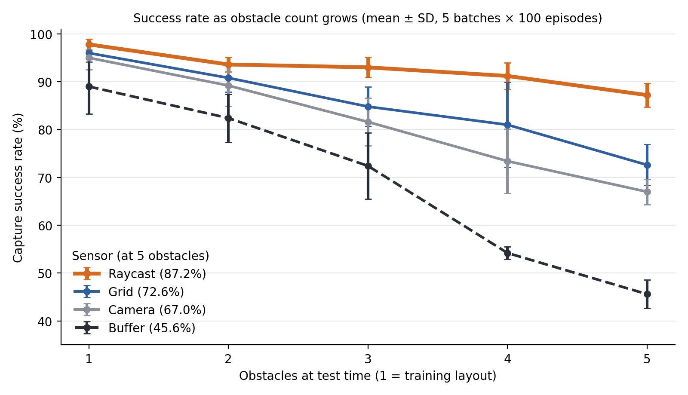

# Adaptability of Unity ML-Agents Sensors for Dynamic Game Environments

Code, trained models, and environments for our EXAG 2026 paper comparing how well four Unity ML-Agents sensor types hold up when a game environment changes after training.

> **Lauren DeMaio and Carmine Guida.** "Adaptability of Unity ML-Agents Sensors for Dynamic Game Environments." *EXAG 2026: AIIDE Workshop on Experimental AI in Games*, CEUR Workshop Proceedings (to appear).



## The question

Game NPCs trained with reinforcement learning are usually trained once, but the games they live in keep changing: new levels, more obstacles, layouts the agent never saw. We asked which of Unity ML-Agents' built-in sensors best equips a trained agent to cope with a more cluttered arena than it was trained in.

## The setup

An RL agent must catch a scripted player before the player walks, in a straight line, to a goal. Every episode randomizes the positions of the agent, player, goal, and obstacles in a 20×20 arena.

| Reward | Event |
|---|---|
| +5 | Agent captures the player |
| −3 | Player reaches the goal |
| −5 | Agent hits a wall or obstacle (episode ends) |

Each agent is trained with PPO for 4M steps in an arena with **one** obstacle, then evaluated with **1 to 5** obstacles (2 to 5 are configurations it never saw). Each condition is 5 batches of 100 episodes.

## The four sensors

| Sensor | What the agent receives | Encoding |
|---|---|---|
| **Raycast** | 13 rays around the agent; each reports what it hit and the distance | Relative distance |
| **Camera** | 84×84 grayscale image, forward-facing | Pixels, no explicit distance |
| **Grid** | 30×30 cells around the agent, one-hot tagged by object type, rotating with the agent | Discretized map |
| **Buffer** | (x, z) world coordinates of the player, goal, and obstacles (plus the player's heading) | Absolute coordinates |

Every agent also receives its own position, heading, and velocity. Sensors are used in their typical configurations, so they also differ in field of view and network size.

## Results

| Obstacles | Raycast | Camera | Grid | Buffer |
|:-:|:-:|:-:|:-:|:-:|
| 1 (training) | **97.8 ± 1.1** | 95.0 ± 2.5 | 96.0 ± 1.9 | 89.0 ± 5.7 |
| 2 | **93.6 ± 1.5** | 89.2 ± 4.3 | 90.8 ± 3.0 | 82.4 ± 5.0 |
| 3 | **93.0 ± 2.1** | 81.6 ± 5.0 | 84.8 ± 4.2 | 72.4 ± 6.9 |
| 4 | **91.2 ± 2.8** | 73.4 ± 6.8 | 81.0 ± 8.9 | 54.2 ± 1.3 |
| 5 | **87.2 ± 2.5** | 67.0 ± 2.7 | 72.6 ± 4.3 | 45.6 ± 3.0 |

Capture success rate (%), mean ± SD over 5 batches of 100 resolved episodes. Raw values are in [`data/success_rates.csv`](data/success_rates.csv).

Raycast degraded the least (−10.6 points from 1 to 5 obstacles) and buffer the most (−43.4 points). We attribute this to raycast's relative-distance encoding, which stays meaningful as obstacles are added, versus buffer's absolute coordinates, which produce combinations never seen in training.

Raycast was also the cheapest sensor to run:

| | Raycast | Camera | Grid | Buffer |
|---|:-:|:-:|:-:|:-:|
| Policy parameters | 0.56M | 2.13M | 0.87M | 0.71M |
| Inference (ms per decision) | 0.27 | 1.36 | 0.60 | 0.66 |

Inference time is the mean time per decision in the Unity Editor on an Apple M3 Pro; source logs are in [`data/inference_timers/`](data/inference_timers/).

**Scope.** Each sensor was trained only once, so these results describe four specific trained agents rather than sensor types in general. Only static obstacles were added; game dynamics were not changed. See the paper for the full discussion of limitations.

## Repository layout

```
Assets/
  Raycast.onnx, Camera.onnx, Grid.onnx, Buffer.onnx   trained policies used in the paper
  Scenes/          one scene per sensor (Raycast, Camera, Grid, Buffer)
  Prefabs/         TrainingArea prefab per sensor (agent, player, goal, walls, sensors)
  Scripts/
    AgentController.cs   observations, actions, rewards, episode reset and spawning
    PlayerController.cs  scripted straight-line player
    Stats.cs             counts captures and failures; stops after 100 resolved episodes
config/            PPO trainer configs for mlagents-learn (identical except for behavior name)
data/
  success_rates.csv      evaluation results (Table 2 in the paper)
  inference_timers/      Unity ML-Agents timer logs used for inference cost
docs/              figures for this README
Packages/, ProjectSettings/   Unity project files
```

## Requirements

- Unity **6000.0.62f1**
- Unity ML-Agents package **4.0.2** (installed automatically from `Packages/manifest.json`)
- Python 3.10 with the `mlagents` package version that matches ML-Agents 4.0 <!-- TODO: add exact mlagents version used -->
- PyTorch (the models were exported with PyTorch 2.8.0)

## Evaluating the trained models

1. Open the project in Unity and open a scene from `Assets/Scenes/`, for example `Raycast.unity`.
2. Select the agent inside the `TrainingArea` and set **Obs Count** on `AgentController` to the number of obstacles to test (1 to 5).
3. Leave **Behavior Type** on Default. The trained `.onnx` model is already assigned and runs in inference mode when no trainer is connected.
4. Press Play. `Stats.cs` logs captures and failures to the Console and exits Play mode after 100 resolved episodes (capture, player reaching the goal, or collision). Each run is one batch; the paper uses five batches per condition.

The environment's random number generator is not seeded, so each batch samples new layouts.

## Retraining

1. Install the Python requirements above.
2. Open the scene for the sensor you want to train and set **Obs Count** to 1.
3. From the repository root, run (Raycast example):
   ```bash
   mlagents-learn config/raycast.yaml --run-id=raycast
   ```
4. Press Play in Unity when prompted. Training runs for 4M steps; the exported model is written to `results/raycast/`.

All four configs use: learning rate 3e-4 (linear decay), batch 2048, buffer 20480, γ 0.995, λ 0.95, ε 0.2, β 0.005, 3 epochs, time horizon 1000, and 3 hidden layers of 512 units. No fixed seed was used in the paper; pass `--seed=<n>` for reproducible runs.

## Citation

```bibtex
@inproceedings{demaio2026adaptability,
  author    = {DeMaio, Lauren and Guida, Carmine},
  title     = {Adaptability of Unity ML-Agents Sensors for Dynamic Game Environments},
  booktitle = {EXAG 2026: AIIDE Workshop on Experimental AI in Games},
  series    = {CEUR Workshop Proceedings},
  year      = {2026},
  note      = {To appear}
}
```

## Authors

Lauren DeMaio and Carmine Guida, Seidenberg School of Computer Science and Information Systems, Pace University.
